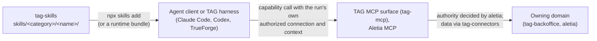

# Architecture

`tag-skills` is a library of documents and small scripts, not a service. It runs nowhere: agent clients copy skills from it and load them locally. Organization-wide architecture is in [.github standards/ARCHITECTURE.md](https://github.com/theapotheosisgroup/.github/blob/main/standards/ARCHITECTURE.md); this file covers only this repository.

The skill only tells the client which logical capability to call and how ([capability contract](docs/integration/capability-contract.md)). Authority comes from the runtime and the owning domain, never from the skill. Integration boundaries and the work pending in other repositories are in [docs/integration/README.md](docs/integration/README.md).

## Owns

- Published skills under `skills/<category>/<name>/`, in the Agent Skills format, with TAG metadata (`tag-skill.json`) and upstream licence and notice files.
- Reporting templates and portable helper scripts inside skills (for example the statement builder in tag-financial-statements), with their evaluations.
- Profiles, the generated catalog, the upstream import record (`upstreams.lock.json`) and the logical capability registry (`docs/integration/capabilities.json`), as contracts.
- The validator, the Skills CLI discovery and installation tests, the profile installer and the upstream comparison tool.
- The list of supported agent clients and the installation instructions ([docs/INSTALLING.md](docs/INSTALLING.md)).

## Does not own

| Not here | Owner |
| --- | --- |
| Agent definitions, the agent registry and the agent plugin format | `tag-agents` (definitions), `tag-platform` (registry deployment) |
| MCP servers, tools and their authorization | `tag-mcp` (the MCP surface for TAG's back office: facade, Back Office MCP, A2A, APIs), the owning domain (`tag-backoffice`) |
| Organizations, persons, roles, nexuses, delegated authority, audit records, expectations | `aletia` |
| Runtime skill discovery, selection, execution state, retries, evidence capture, review routing | `tag-harness` (agents run through TrueForge) |
| Deployment, edge, the Hydra authorization server | `tag-platform` |
| Domain logic, including the back-office handlers in `agents/pillars/skills.py` | `tag-backoffice` (the name collision with "skills" is only a name) |
| Prompts hashed by attestation digests (`prompts/*.md`) | `tag-backoffice` |
| Credentials, tokens, provider connections and adapters (ledgers, documents, storage including OpenDAL) | `tag-connectors`; identity in `aletia` |
| Organization standards and shared CI | `.github` |

## Forbidden dependencies

From the foundation prompt, section 5. The rules that apply to this repository:

- **A skill directly modifying an organization's ledger.** A skill never writes a ledger or business record itself, and ships no script that does. It asks the owning domain through its MCP tools.
- **A frontend bypassing authoritative authorization**, and its equivalent here: a skill never works around an MCP capability's authorization, for example by calling a private endpoint, embedding a token or reusing another identity.
- **An agent using a global administrator identity for customer reads.** A skill never tells an agent to use a shared or administrator identity.
- **Multiple services independently implementing ledger-write semantics.** A skill describes how to use a capability; it never re-implements domain rules such as accounting logic.

And, specific to this repository:

- A skill depends on nothing outside its own directory except pinned, reviewed dependencies it declares (interpreters, other TAG skills in `tag-skill.json`, logical capabilities).
- The repository's tooling depends only on the packages in `package-lock.json`. Skills never import the tooling.
- No other TAG repository depends on this repository's code. Clients consume skills as files.
