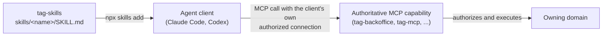

# Architecture

`tag-skills` is a library of documents and small scripts, not a service. It runs nowhere: agent clients copy skills from it and load them locally. Organization-wide architecture is in [.github standards/ARCHITECTURE.md](https://github.com/theapotheosisgroup/.github/blob/main/standards/ARCHITECTURE.md); this file covers only this repository.

The skill only tells the client which capability to call and how. Authority comes from the MCP connection, never from the skill.

## Owns

- Published skills under `skills/`, in the Agent Skills format.
- The validator, the Skills CLI discovery and installation smoke tests, and the tests for skill scripts.
- The list of supported agent clients and the installation instructions ([docs/INSTALLING.md](docs/INSTALLING.md)).

## Does not own

| Not here | Owner |
| --- | --- |
| Agent definitions, the agent registry and the agent plugin format | `tag-agents` (definitions), `tag-platform` (registry deployment) |
| MCP servers, tools and their authorization | the owning domain (for example `tag-backoffice`), and `tag-mcp` for the client-facing facade |
| Domain logic, including the back-office handlers in `agents/pillars/skills.py` | `tag-backoffice` (the name collision with "skills" is only a name) |
| Prompts hashed by attestation digests (`prompts/*.md`) | `tag-backoffice` |
| Credentials, tokens and provider connections | the identity and connector owners (`aletia`, `tag-connectors`) |
| Organization standards and shared CI | `.github` |

## Forbidden dependencies

From the foundation prompt, section 5. The rules that apply to this repository:

- **A skill directly modifying an organization's ledger.** A skill never writes a ledger or business record itself, and ships no script that does. It asks the owning domain through its MCP tools.
- **A frontend bypassing authoritative authorization**, and its equivalent here: a skill never works around an MCP capability's authorization, for example by calling a private endpoint, embedding a token or reusing another identity.
- **An agent using a global administrator identity for customer reads.** A skill never tells an agent to use a shared or administrator identity.
- **Multiple services independently implementing ledger-write semantics.** A skill describes how to use a capability; it never re-implements domain rules such as accounting logic.

And, specific to this repository:

- A skill depends on nothing outside its own directory except pinned, reviewed dependencies it declares.
- The repository's tooling depends only on the packages in `package-lock.json`. Skills never import the tooling.
- No other TAG repository depends on this repository's code. Clients consume skills as files.
